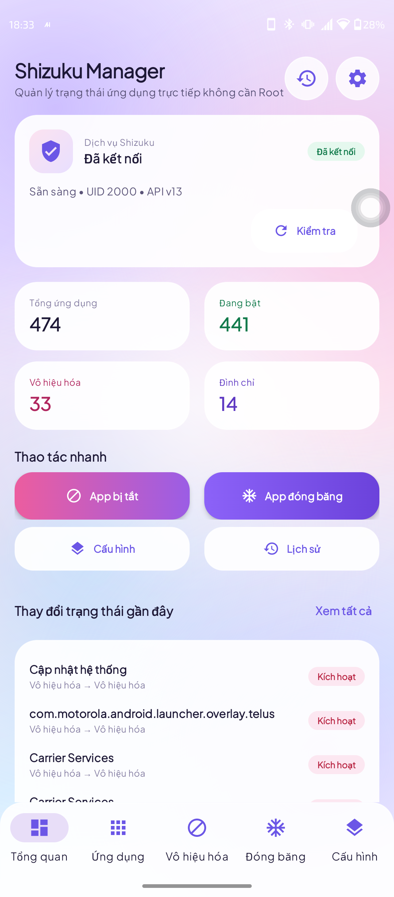
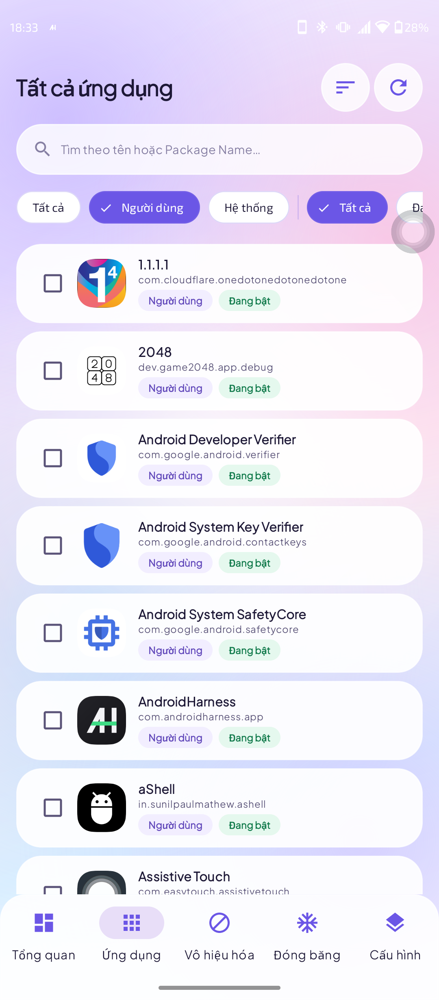
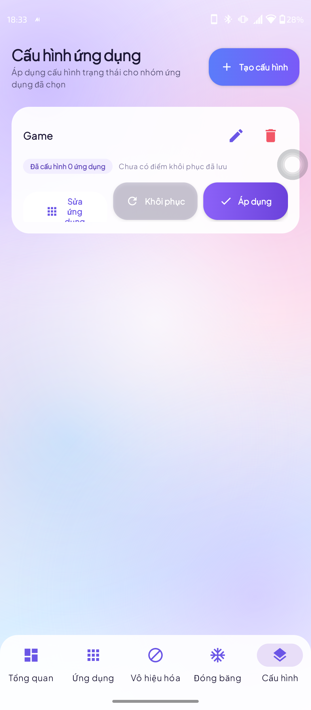

# Shizuku Manager

Manage installed Android app states (Enable, Disable, Suspend, Freeze, Force Stop, Uninstall) via Shizuku — no root required.

[](https://opensource.org/licenses/MIT)
[](https://developer.android.com/about/versions)
[](https://developer.android.com/about/versions)

## Screenshots

<table>
  <tr>
    <td><b>Dashboard</b></td>
    <td><b>All Apps</b></td>
    <td><b>Disabled Apps</b></td>
  </tr>
  <tr>
    <td></td>
    <td></td>
    <td></td>
  </tr>
  <tr>
    <td><b>App Details</b></td>
    <td><b>Profiles</b></td>
    <td><b>Settings</b></td>
  </tr>
  <tr>
    <td></td>
    <td></td>
    <td></td>
  </tr>
</table>

Screenshots luu trong thu muc `Screenshot/`. Tat ca anh duoc chup tu ung dung thuc su, khong su dung mockup.

## Key Features

- **Enable / Disable** — Bat tat hoac vo hieu hoa ung dung qua PackageManager
- **Suspend / Unsuspend** — Dong bang / mo dong bang ung dung (Android 10+)
- **Freeze / Unfreeze** — Dong bang / mo dong bang bang Shizuku UserService
- **Force Stop** — Buoc dung ung dung dang chay
- **Uninstall** — Goi cai dat ung dung (khong bao gom ung dung chinh minh)
- **App Profiles** — Luu va ap bang tap hieu lenh vao nhieu cung luc (Gaming, Daily, Minimal...)
- **Operation History** — Luu lich su tat ca cac thao tac da thuc hien
- **Shizuku Integration** — Ket noi voi dich vu Shizuku de lay quyen cao cap khong can Root
- **Localization** — Ho tro tieng Anh va tieng Viet
- **Dark-friendly glassmorphism UI** — Giao dien Material Design 3 voi hieu ung gradient nen

## Technology Stack

| Layer | Technology |
|-------|-----------|
| Language | Java 11 |
| UI | Android Views, Material Design 3, Navigation Component |
| DI | Manual Dependency Injection (no Dagger/Hilt) |
| Database | AndroidX Room (SQLite) |
| JSON | Gson |
| Shizuku | Shizuku API (Rikka) |
| Build | Gradle Kotlin DSL, AGP 9.1.1 |
| Tests | JUnit 4, Robolectric, Espresso |

## Architecture Overview

Dự án sử dụng mô hình **Manual DI + Repository + MVVM** với luồng dữ liệu một chiều:

```
View  <--->  ViewModel  <--->  Repository  <--->  Data Sources
                                        (Room, PackageManager, Shizuku)
```

- **Manual DI** (`AppContainer`) — Quản lý vòng đời các thành phần, không phụ thuộc framework DI nặng.
- **Repository** — Trung tâm truy cập dữ liệu: `AppRepository` (trang thai ung dung), `ProfileRepository` (cau hinh profile), `HistoryRepository` (lich su thao tac).
- **ViewModel** — Giữ trạng thái UI, xử lý sự kiện, không trực tiếp thao tác Android Framework.
- **Data Sources** — `SystemPackageScanner` (PackageManager), `ShizukuConnectionManager` (Shizuku Binder), `AppDatabase` (Room).

## Project Structure

```
shizuku-manager/
├── app/
│   ├── build.gradle.kts
│   ├── proguard-rules.pro
│   └── src/
│       ├── main/
│       │   ├── AndroidManifest.xml
│       │   ├── aidl/com/shizukumanager/app/shizuku/aidl/
│       │   ├── java/com/shizukumanager/
│       │   │   ├── database/          # Room entities, DAOs, AppDatabase
│       │   │   ├── di/                # Manual DI container
│       │   │   ├── model/             # Data models, enums, result objects
│       │   │   ├── pkg/               # Package scanning & operations
│       │   │   ├── repository/        # Repository layer
│       │   │   ├── shizuku/           # Shizuku connection & shell service
│       │   │   ├── ui/                # Activities, fragments, adapters, dialogs, views
│       │   │   ├── util/              # Utilities (icons, preferences, labels, dates)
│       │   │   └── viewmodel/         # MVVM ViewModels
│       │   └── res/                   # Resources (layouts, drawables, values, navigation)
│       └── test/                      # Unit tests (JUnit, Robolectric)
│       └── androidTest/               # Instrumented tests (Espresso)
├── docs/
│   ├── ARCHITECTURE.md
│   ├── BUILDING.md
│   ├── CHANGELOG.md
│   ├── RELEASE.md
│   └── RELEASE_AUDIT.md
├── Screenshot/                        # App screenshots
├── build.gradle.kts
├── gradle.properties                  # Local Gradle settings (not committed)
├── gradle/libs.versions.toml
├── signing.properties.example         # Copy to signing.properties for Release builds
├── settings.gradle.kts
├── LICENSE                            # MIT License
└── README.md
```

## Requirements

- Android Studio (latest stable)
- Android SDK API 36 (compileSdk), minSdk 24
- JDK 11+
- Shizuku app installed on device/emulator (for full functionality)
- Git (for cloning)

## Installation

```bash
# Clone repository
git clone https://github.com/your-username/shizuku-manager.git
cd shizuku-manager

# Open in Android Studio
# File > Open > select shizuku-manager/ directory
# Sync project with Gradle files
```

## Build Instructions

### Debug Build (khong can cau hinh them)

```bash
./gradlew assembleDebug
```

APK se duoc tao tai `app/build/outputs/apk/debug/`.

### Release Build (can cau hinh ky)

1. Tao file `signing.properties` tu `signing.properties.example`:
   ```bash
   cp signing.properties.example signing.properties
   ```

2. Chinh sua `signing.properties` voi thong tin keystore cua ban:
   ```
   storeFile=path/to/release-key.jks
   storePassword=YOUR_STORE_PASSWORD
   keyAlias=YOUR_KEY_ALIAS
   keyPassword=YOUR_KEY_PASSWORD
   ```

3. Build Release:
   ```bash
   ./gradlew assembleRelease
   ```

Neu `signing.properties` chua ton tai hoac chua day du, Build se that bai voi thong bao loi ro rang.

## Release Signing Configuration

Thong tin ky Release khong duoc luu trong repository. Nguoi dung phai tu tao file `signing.properties` tu `signing.properties.example`.

- `signing.properties` da duoc them vao `.gitignore` (khong bao gio duoc commit)
- `release-key.jks` da duoc xoa khoi repository (bao mat)
- Debug build su dung `debug.keystore` mac dinh cua Android SDK (khong can cau hinh)

## Localization

Ung dung ho tro hai ngon ngu:
- **Tieng Anh** (`res/values/strings.xml`) — mac dinh
- **Tieng Viet** (`res/values-vi/strings.xml`)

Ngon ngu co the thay doi trong man hinh Cai dat > Ngon ngu. Ung dung su dung `AppCompatDelegate.setApplicationLocales()` de ho tro thay doi ngon ngu luot tai khong can khoi dong ung dung (Android 7+).

## Contribution

Chung toi chao danh tat ca cac dong gop. Xem huong dan chi tiet tai:

- [CONTRIBUTING.md](CONTRIBUTING.md) — Moi truong phat trien, cai dat, quy trinh Pull Request
- [CODE_OF_CONDUCT.md](CODE_OF_CONDUCT.md) — Quy tac hoa cong dong
- [SECURITY.md](SECURITY.md) — Ba cao lo hinh bao mat

### Cach dong gop

1. Fork repository
2. Tao branch moi (`git checkout -b feature/ten-tinh-nang`)
3. Thay doi code va commit (`git commit -m "feat: mo ta tinh nang"`)
4. Push len branch (`git push origin feature/ten-tinh-nang`)
5. Tao Pull Request

## License

Du an duoc phat hanh giua [MIT License](LICENSE).

## Acknowledgments

- [Shizuku](https://shizuku.rikka.app/) (Rikka) — Cung cap API ket noi khong can Root
- [AndroidX](https://developer.android.com/jetpack/androidx) — Room, Navigation, Lifecycle, Material Components
- [Gson](https://github.com/google/gson) — Xu ly JSON cho xuat/nhap Profile
- [Material Design 3](https://m3.material.io/) — He thong thiet mat giao dien
