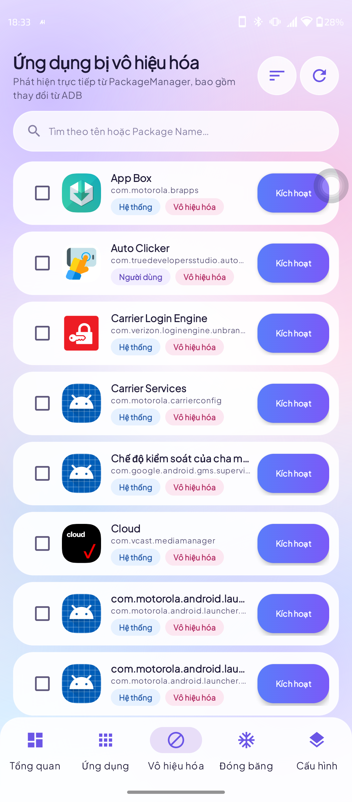
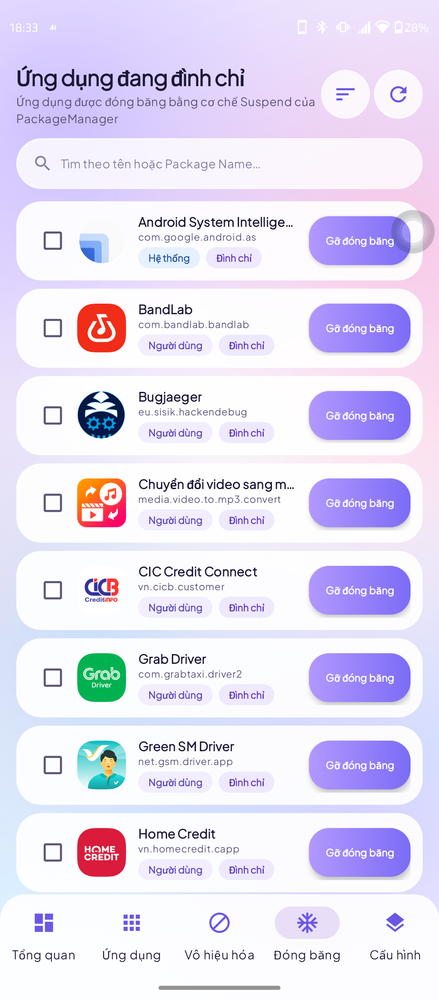
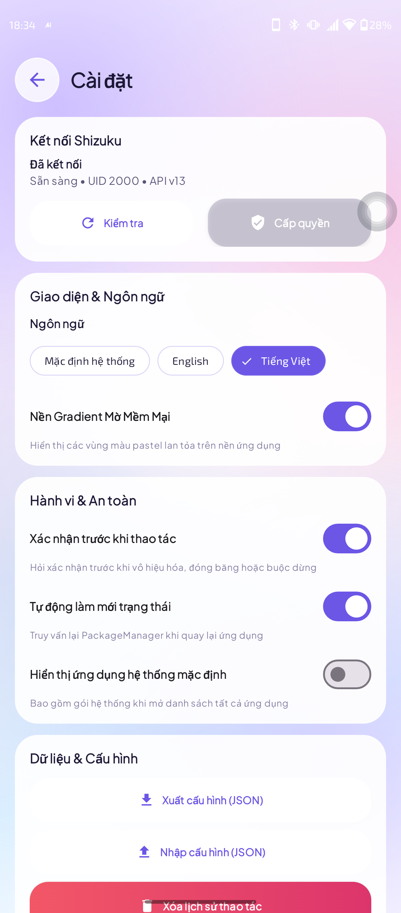

# Shizuku Manager

Manage installed Android app states (Enable, Disable, Suspend, Freeze, Force Stop, Uninstall) via Shizuku — no root required.

[](https://opensource.org/licenses/MIT)
[](https://developer.android.com/about/versions)
[](https://developer.android.com/about/versions)

## Screenshots

<table>
  <tr>
    <td><b>Dashboard</b></td>
    <td><b>All Apps</b></td>
    <td><b>Disabled Apps</b></td>
  </tr>
  <tr>
    <td></td>
    <td></td>
    <td></td>
  </tr>
  <tr>
    <td><b>App Details</b></td>
    <td><b>Profiles</b></td>
    <td><b>Settings</b></td>
  </tr>
  <tr>
    <td></td>
    <td></td>
    <td></td>
  </tr>
</table>

Screenshots are stored in the `Screenshot/` directory. All images are captured from the actual application; no mockups are used.

## Key Features

- **Enable / Disable** — Enable or disable apps via PackageManager
- **Suspend / Unsuspend** — Suspend or unsuspend apps (Android 10+)
- **Freeze / Unfreeze** — Freeze or unfreeze apps via Shizuku UserService
- **Force Stop** — Force stop running apps
- **Uninstall** — Uninstall apps (excluding the app itself)
- **App Profiles** — Save and apply command batches to multiple apps at once (Gaming, Daily, Minimal...)
- **Operation History** — Record all operations performed
- **Shizuku Integration** — Connect to Shizuku service for elevated privileges without root
- **Localization** — Supports English and Vietnamese
- **Dark-friendly glassmorphism UI** — Material Design 3 with gradient background effects

## Technology Stack

| Layer | Technology |
|-------|-----------|
| Language | Java 11 |
| UI | Android Views, Material Design 3, Navigation Component |
| DI | Manual Dependency Injection (no Dagger/Hilt) |
| Database | AndroidX Room (SQLite) |
| JSON | Gson |
| Shizuku | Shizuku API (Rikka) |
| Build | Gradle Kotlin DSL, AGP 9.1.1 |
| Tests | JUnit 4, Robolectric, Espresso |

## Architecture Overview

The project uses **Manual DI + Repository + MVVM** architecture with a unidirectional data flow:

```
View  <--->  ViewModel  <--->  Repository  <--->  Data Sources
                                        (Room, PackageManager, Shizuku)
```

- **Manual DI** (`AppContainer`) — Manages component lifecycles without heavyweight DI frameworks.
- **Repository** — Central data access: `AppRepository` (app states), `ProfileRepository` (profile configs), `HistoryRepository` (operation history).
- **ViewModel** — Holds UI state and handles events without directly touching Android Framework.
- **Data Sources** — `SystemPackageScanner` (PackageManager), `ShizukuConnectionManager` (Shizuku Binder), `AppDatabase` (Room).

## Project Structure

```
shizuku-manager/
├── app/
│   ├── build.gradle.kts
│   ├── proguard-rules.pro
│   └── src/
│       ├── main/
│       │   ├── AndroidManifest.xml
│       │   ├── aidl/com/shizukumanager/app/shizuku/aidl/
│       │   ├── java/com/shizukumanager/
│       │   │   ├── database/          # Room entities, DAOs, AppDatabase
│       │   │   ├── di/                # Manual DI container
│       │   │   ├── model/             # Data models, enums, result objects
│       │   │   ├── pkg/               # Package scanning & operations
│       │   │   ├── repository/        # Repository layer
│       │   │   ├── shizuku/           # Shizuku connection & shell service
│       │   │   ├── ui/                # Activities, fragments, adapters, dialogs, views
│       │   │   ├── util/              # Utilities (icons, preferences, labels, dates)
│       │   │   └── viewmodel/         # MVVM ViewModels
│       │   └── res/                   # Resources (layouts, drawables, values, navigation)
│       ├── test/                      # Unit tests (JUnit, Robolectric)
│       └── androidTest/               # Instrumented tests (Espresso)
├── docs/
│   ├── ARCHITECTURE.md
│   ├── BUILDING.md
│   ├── CHANGELOG.md
│   └── RELEASE.md
├── Screenshot/                        # App screenshots
├── build.gradle.kts
├── gradle.properties                  # Local Gradle settings (not committed)
├── gradle/libs.versions.toml
├── signing.properties.example         # Copy to signing.properties for Release builds
├── settings.gradle.kts
├── LICENSE                            # MIT License
└── README.md
```

## Requirements

- Android Studio (latest stable release)
- Android SDK API 36 (compileSdk), minSdk 24
- JDK 11+
- Shizuku app installed on device/emulator (for full functionality)

## Installation

```bash
git clone https://github.com/nguyenthanhan12062001/AppManager--shizukuapi.git
cd shizuku-manager
```

Open the `shizuku-manager/` directory in Android Studio and sync Gradle files.

## Build Instructions

### Debug Build (no signing configuration required)

```bash
./gradlew assembleDebug
```

The APK is generated at `app/build/outputs/apk/debug/`.

### Release Build (signing configuration required)

Release builds require a signing configuration. Private keystore credentials are **not** included in the repository.

1. Copy `signing.properties.example` to `signing.properties`:

   ```bash
   cp signing.properties.example signing.properties
   ```

2. Edit `signing.properties` with your own keystore values:

   ```
   storeFile=path/to/release-key.jks
   storePassword=YOUR_STORE_PASSWORD
   keyAlias=YOUR_KEY_ALIAS
   keyPassword=YOUR_KEY_PASSWORD
   ```

3. Build the Release APK:

   ```bash
   ./gradlew assembleRelease
   ```

If `signing.properties` is missing or incomplete, the build fails with a clear error message.

## Release Signing Configuration

Release signing information is not stored in the repository. Users must create their own `signing.properties` from `signing.properties.example`.

- `signing.properties` is listed in `.gitignore` and must never be committed.
- `release-key.jks` has been removed from the repository (security).
- Debug build uses the default Android SDK `debug.keystore` (no configuration required).

## Localization

The application supports two languages:

- **English** (`res/values/strings.xml`) — default
- **Vietnamese** (`res/values-vi/strings.xml`)

The language can be changed in Settings > Language. The app uses `AppCompatDelegate.setApplicationLocales()` to support language changes at runtime without restarting (Android 7+).

## Contribution

We welcome all contributions. See the detailed guide at:

- [CONTRIBUTING.md](CONTRIBUTING.md) — Development environment, setup, Pull Request process
- [CODE_OF_CONDUCT.md](CODE_OF_CONDUCT.md) — Community guidelines
- [SECURITY.md](SECURITY.md) — Security vulnerability reporting

### How to contribute

1. Fork the repository
2. Create a new branch (`git checkout -b feature/feature-name`)
3. Make changes and commit (`git commit -m "feat: describe feature"`)
4. Push to the branch (`git push origin feature/feature-name`)
5. Open a Pull Request

## License

This project is licensed under the [MIT License](LICENSE).

## Acknowledgments

- [Shizuku](https://shizuku.rikka.app/) (Rikka) — Provides the API for non-root connections
- [AndroidX](https://developer.android.com/jetpack/androidx) — Room, Navigation, Lifecycle, Material Components
- [Gson](https://github.com/google/gson) — JSON processing for Profile export/import
- [Material Design 3](https://m3.material.io/) — Design system for the UI
